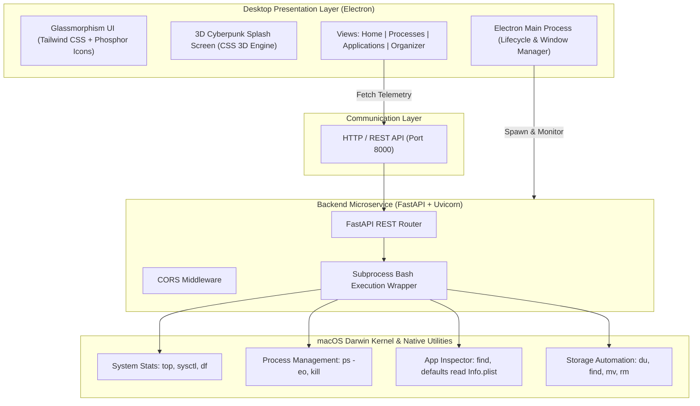

<div align="center">

# ⚡ NEXYRA
### Next-Gen System Monitor, Process Controller & Automation Suite

[](https://apple.com)
[](https://www.electronjs.org/)
[](https://fastapi.tiangolo.com/)
[](https://www.python.org/)
[](https://nodejs.org/)
[](https://tailwindcss.com/)
[](LICENSE)

<p align="center">
  <b>Nexyra</b> is an operating system utility suite combining modern <b>Glassmorphism UI</b> with high-performance <b>FastAPI</b> backend microservices and native <b>POSIX bash automation</b>. Designed for real-time telemetry, automated directory hygiene, process control, and system cleanup.
</p>

---

</div>

## 📑 Table of Contents
- [✨ Key Features](#-key-features)
- [🏛️ System Architecture](#️-system-architecture)
- [📂 Project Structure](#-project-structure)
- [🚀 Quick Start & Installation](#-quick-start--installation)
- [🛠️ Available Scripts](#️-available-scripts)
- [🔌 REST API Reference](#-rest-api-reference)
- [💻 Native OS Automation Scripts](#-native-os-automation-scripts)
- [🔐 Security & Environment Variables](#-security--environment-variables)
- [📜 License](#-license)

---

## ✨ Key Features

- **📊 Real-time Hardware Telemetry**
  - Live CPU core utilization tracking.
  - Unified Physical Memory (`PhysMem`) and total RAM calculation via `sysctl`.
  - Boot partition disk usage, available storage, and capacity visualization.

- **⚡ Process Manager & Task Control**
  - Interactive table of active system processes (PID, Command, %CPU, %MEM).
  - Search and filter processes with real-time refresh.
  - Safe process termination with dual-confirmation modal shields (`SIGKILL / kill -9`).

- **📦 Application Ecosystem Inspector**
  - Deep scan of system `/Applications` and user space.
  - Metadata harvesting via macOS `defaults` (`CFBundleShortVersionString`).
  - Vendor classification (Apple, Google, Microsoft, Adobe, JetBrains, Spotify, etc.).

- **🧹 Automated Storage Hygiene & Junk Cleaner**
  - Live calculation of temporary cache and diagnostic logs (`~/Library/Caches`, `~/Library/Logs`).
  - One-click safe cache flushing to reclaim disk space.

- **🗂️ Smart File & Workspace Organizer**
  - Automated sorting for congested folders (e.g. `~/Downloads`).
  - Sorts files into structured folders: `Images`, `Documents`, `Archives`, and `Videos`.
  - Live preview of unorganized files with file-type color tagging and file sizes.

- **🎨 Cyberpunk / Glassmorphism Desktop UI**
  - Custom Electron desktop window with smooth 3D CSS cube animation and ambient particle engine.
  - Responsive collapsible sidebar with active status indicators and toast feedback.

---

## 🏛️ System Architecture



---

## 📂 Project Structure

```text
Nexyra/
├── backend/
│   ├── main.py              # FastAPI server, CORS configuration, API routes
│   └── requirements.txt     # Python dependencies (FastAPI, Uvicorn, etc.)
├── electron/
│   ├── main.js              # Electron app entry point, process lifecycle manager
│   ├── package.json         # Electron dependencies and scripts
│   └── package-lock.json    # Locked node dependency tree
├── frontend/
│   ├── splash_screen/
│   │   └── splash.html      # 3D animated splash screen with particle engine
│   └── views/
│       ├── home.html        # Main telemetry dashboard (CPU, RAM, Disk, System)
│       ├── processes.html   # Real-time task manager & process terminator
│       ├── applications.html# Installed application browser and metadata viewer
│       └── organizer.html   # Smart file organizer & cache junk cleaner
├── scripts/
│   ├── os_tasks/
│   │   ├── applications.sh  # Scans installed .app bundles
│   │   ├── clean_junk.sh    # Flushes system user cache & logs safely
│   │   ├── kill_process.sh  # Terminates target PID via kill signal
│   │   ├── organizer.sh     # Auto-categorizes files into organized folders
│   │   ├── processes.sh     # Extracts top processes with CPU and RAM %
│   │   ├── setup_demo.sh    # Generates mock files for testing organizer
│   │   └── sys_info.sh      # Gathers hardware metrics from Darwin kernel
│   └── syatem_info/
│       └── get_system_info.sh
├── .env.example             # Example environment template
├── .gitignore               # Strict gitignore protecting secrets and artifacts
├── package.json             # Root workspace runner
└── README.md                # Project documentation
```

---

## 🚀 Quick Start & Installation

### Prerequisites
- **Operating System**: macOS (features utilize native Darwin commands like `sysctl`, `defaults`, and `top`).
- **Node.js**: v18.0.0 or higher.
- **Python**: v3.10 or higher.

### 1. Clone the Repository
```bash
git clone git@github.com:methun404/Nexyra.git
cd Nexyra
```

### 2. Configure Environment Variables
Copy the template configuration:
```bash
cp .env.example .env
```

### 3. Setup Python Backend Environment
```bash
# Create Python virtual environment inside backend/
python3 -m venv backend/venv

# Activate the virtual environment
source backend/venv/bin/activate

# Install backend dependencies
pip install -r backend/requirements.txt
```

### 4. Install Electron Dependencies
```bash
npm --prefix electron install
```

### 5. Launch the Application
Run everything with a single command from the project root:
```bash
npm start
```
*Electron will automatically launch the 3D splash screen, spin up the FastAPI server on `http://127.0.0.1:8000`, verify server health, and transition to the dashboard once ready.*

---

## 🛠️ Available Scripts

From the root project directory:

| Command | Description |
|---|---|
| `npm start` | Launches both the FastAPI backend and the Electron desktop app |
| `npm run electron` | Starts the Electron wrapper directly |
| `npm run backend` | Runs the FastAPI backend in standalone reload mode on port `8000` |

---

## 🔌 REST API Reference

The FastAPI service exposes the following endpoints on `http://127.0.0.1:8000`:

| Method | Endpoint | Description | Sample Output |
|---|---|---|---|
| `GET` | `/` | Service health status check | `{"status": "ok"}` |
| `GET` | `/api/sysinfo` | Real-time CPU, RAM and Disk metrics | `{"cpu":"18.4","ram_used":"7120M","ram_total":"8 GB",...}` |
| `GET` | `/api/processes` | List of top 30 active OS processes | `{"processes":[{"pid":"123","name":"Chrome","cpu":"4.2","mem":"2.1"}]}` |
| `POST` | `/api/process/kill/{pid}`| Terminates process by PID | `{"result":"Success"}` |
| `GET` | `/api/apps` | Installed applications and metadata | `{"applications":[{"name":"Slack","publisher":"Slack","version":"4.38"}]}` |
| `GET` | `/api/junk/size` | Calculates safe-to-clean junk size | `{"size_gb":"2.4 GB","raw_bytes":2576980377}` |
| `POST` | `/api/clean` | Flushes user caches and log buffers | `{"status":"success","message":"System Cleanup Finished"}` |
| `GET` | `/api/files/unorganized` | Scans files waiting in `~/Downloads` | `{"files":[...],"path":"/Users/.../Downloads"}` |
| `POST` | `/api/organize` | Sorts Downloads files into categories | `{"status":"success","message":"Organized /Users/.../Downloads"}` |

---

## 💻 Native OS Automation Scripts

All backend routes execute hardened bash scripts located in `scripts/os_tasks/`:

- **`sys_info.sh`**: Interrogates `top -l 1`, `sysctl -n hw.memsize`, and `df -h /` to parse real hardware loads.
- **`processes.sh`**: Runs `ps -eo pid,pcpu,pmem,comm -m` with awk formatting for reliable delimiter parsing.
- **`kill_process.sh`**: Dispatches `kill -9` with safety parameter validation.
- **`clean_junk.sh`**: Safely cleans temporary `.tmp` and `.log` files, with dedicated cleanup routines for `~/Library/Caches` and `~/Library/Logs`.
- **`organizer.sh`**: Uses shell case-insensitive globbing (`nocaseglob`) to sort extensions (`jpg`, `pdf`, `zip`, `mp4`, etc.) into categorized sub-folders without overwriting data.
- **`setup_demo.sh`**: Generates a sandboxed `test_workspace/` directory with test assets to demonstrate organizer and cleaning tasks without touching personal files.

---

## 🔐 Security & Environment Variables

- `.env` files containing secrets or private tokens are strictly ignored by `.gitignore`.
- Destructive actions (killing processes, wiping cache directories, or moving files) require user confirmation through modal dialogs in the UI.
- All process calls avoid shell injection by sanitizing path inputs and executing scripts with fixed bash flags.

---

## 📜 License

This project is licensed under the **MIT License**. Feel free to use, modify, and distribute as per the license conditions.

---

<div align="center">
  <b>Developed by Methun Ahmed</b><br>
  Built with passion for OS telemetry and desktop engineering.
</div>
